<!-- Generated by github.com/trick77/ship/kit/schemadoc, do not edit. Regenerate: SCHEMADOC_UPDATE=1 go test ./... -run TestSchemaDoc -->

# Database schema

27 tables; the diagram is at the end. Go types are the `model.go` structs whose rows they hold.

## activity_events

Go types:

- `activity.Event` (internal/activity): Event is one recorded piece of automatic work. Subject is the display name frozen at write time (this log outlives the video/channel it names), so it is never re-joined.

| Column | Type | Null | Default | PK |
| --- | --- | --- | --- | --- |
| `id` | INTEGER | yes |  | 1 |
| `at` | TEXT | no | `datetime('now')` |  |
| `kind` | TEXT | no |  |  |
| `outcome` | TEXT | no |  |  |
| `subject_id` | TEXT | no | `''` |  |
| `subject` | TEXT | no | `''` |  |
| `summary` | TEXT | no | `''` |  |
| `detail` | TEXT | no | `''` |  |

## auto_unsubscribes

Go types:

- `channels.AutoUnsubscribed` (internal/channels): AutoUnsubscribed is a channel joined with the record of why (and when) peeq unsubscribed it on its own.

| Column | Type | Null | Default | PK |
| --- | --- | --- | --- | --- |
| `channel_id` | TEXT | yes |  | 1 |
| `reason` | TEXT | no |  |  |
| `at` | TEXT | no | `datetime('now')` |  |

Foreign keys:

- `channel_id` → `channels` (`id`), on delete CASCADE

## channel_images

Go types:

- `channels.Image` (internal/channels): Image is one stored channel avatar or banner.

| Column | Type | Null | Default | PK |
| --- | --- | --- | --- | --- |
| `channel_id` | TEXT | no |  | 1 |
| `kind` | TEXT | no |  | 2 |
| `mime` | TEXT | no |  |  |
| `bytes` | BLOB | no |  |  |
| `updated_at` | TEXT | no | `datetime('now')` |  |

Foreign keys:

- `channel_id` → `channels` (`id`), on delete CASCADE

Indexes:

- `idx_channel_images_version` (`channel_id`, `kind`, `updated_at`)

## channel_subcategories

| Column | Type | Null | Default | PK |
| --- | --- | --- | --- | --- |
| `channel_id` | TEXT | no |  | 1 |
| `subcategory` | TEXT | no |  | 2 |
| `rank` | INTEGER | no |  |  |

Foreign keys:

- `channel_id` → `channels` (`id`), on delete CASCADE

Indexes:

- `idx_channel_subcategories_sub` (`subcategory`, `channel_id`)

## channel_subcategory_state

| Column | Type | Null | Default | PK |
| --- | --- | --- | --- | --- |
| `channel_id` | TEXT | yes |  | 1 |
| `manual` | INTEGER | no | `0` |  |
| `video_count` | INTEGER | no | `0` |  |
| `classified_at` | TEXT | no | `datetime('now')` |  |

Foreign keys:

- `channel_id` → `channels` (`id`), on delete CASCADE

## channel_videos

Go types:

- `channelvideos.CaptionCandidate` (internal/channelvideos): CaptionCandidate is a ledger row that is due a caption fetch. It is a narrower shape than Entry on purpose: adding the caption columns to Entry would change scanRow and every reader of it, for the benefit of exactly one caller.
- `channelvideos.Entry` (internal/channelvideos): Entry mirrors one row of the channel_videos table. DecidedAt is an empty string when the underlying column is NULL (no decision made yet). DurationSeconds is 0 when unknown (NULL in the DB); callers filtering on duration should fail open on 0.

| Column | Type | Null | Default | PK |
| --- | --- | --- | --- | --- |
| `video_id` | TEXT | yes |  | 1 |
| `channel_id` | TEXT | no |  |  |
| `title` | TEXT | no | `''` |  |
| `duration_seconds` | INTEGER | yes |  |  |
| `url` | TEXT | no | `''` |  |
| `thumbnail_url` | TEXT | no | `''` |  |
| `state` | TEXT | no | `'seen'` |  |
| `discovered_at` | TEXT | no | `datetime('now')` |  |
| `decided_at` | TEXT | yes |  |  |
| `published_at` | TEXT | yes |  |  |
| `unavailable_reason` | TEXT | no | `''` |  |
| `unavailable_at` | TEXT | yes |  |  |
| `caption_attempts` | INTEGER | no | `0` |  |
| `next_caption_attempt_at` | TEXT | yes |  |  |
| `caption_last_error` | TEXT | no | `''` |  |

Foreign keys:

- `channel_id` → `channels` (`id`), on delete CASCADE

Indexes:

- `idx_channel_videos_channel_discovered` (`channel_id`, `discovered_at`)
- `idx_channel_videos_channel_state` (`channel_id`, `state`)
- `idx_channel_videos_state` (`state`)

## channels

Go types:

- `channels.Channel` (internal/channels): Channel mirrors one row of the channels table. A Channel may exist purely as a metadata cache entry: AddedAt is empty for a channel the user has visited but never added. Subscribers is 0 when YouTube did not report a count (it is hidden, or the channel has never been resolved) — callers must treat 0 as "unknown", not as a real zero. ResolveOk records whether the LAST resolve attempt actually succeeded; ResolvedAt is stamped either way, so ResolveOk is the only thing that distinguishes fresh metadata from a failed attempt that gave up.
- `channels.ListItem` (internal/channels): ListItem is a channel joined with its (optional) subscription state, plus counts used by the channels list UI.
- `channels.SearchableChannel` (internal/channels): SearchableChannel is a channel whose videos the MCP server offers: the narrow projection the channel hint and list_youtube_channels read.
- `channels.SubcategorizeCandidate` (internal/channels): SubcategorizeCandidate is a channel the subcategory sweep owes an answer, with what the classifier reads.

| Column | Type | Null | Default | PK |
| --- | --- | --- | --- | --- |
| `id` | TEXT | yes |  | 1 |
| `handle` | TEXT | no | `''` |  |
| `name` | TEXT | no | `''` |  |
| `description` | TEXT | no | `''` |  |
| `resolved_at` | TEXT | yes |  |  |
| `added_at` | TEXT | yes |  |  |
| `first_seen_at` | TEXT | no | `datetime('now')` |  |
| `subscriber_count` | INTEGER | no | `0` |  |
| `verified` | INTEGER | no | `0` |  |
| `resolve_ok` | INTEGER | no | `0` |  |
| `auto_summary` | INTEGER | no | `1` |  |
| `keep_reads` | INTEGER | no | `1` |  |

Indexes:

- `idx_channels_added_at` (`added_at`)

## download_jobs

Go types:

- `jobs.Job` (internal/jobs): Job mirrors one row of the download_jobs table. StartedAt and FinishedAt are empty strings when the underlying column is NULL (job not yet started / not yet finished).

| Column | Type | Null | Default | PK |
| --- | --- | --- | --- | --- |
| `id` | INTEGER | yes |  | 1 |
| `video_id` | TEXT | no |  |  |
| `state` | TEXT | no | `'pending'` |  |
| `priority` | INTEGER | no | `0` |  |
| `attempts` | INTEGER | no | `0` |  |
| `max_attempts` | INTEGER | no | `3` |  |
| `last_error` | TEXT | no | `''` |  |
| `log_tail` | TEXT | no | `''` |  |
| `enqueued_at` | TEXT | no | `datetime('now')` |  |
| `started_at` | TEXT | yes |  |  |
| `finished_at` | TEXT | yes |  |  |
| `next_attempt_at` | TEXT | yes |  |  |

Foreign keys:

- `video_id` → `videos` (`id`), on delete CASCADE

Indexes:

- `idx_download_jobs_state` (`state`)
- `idx_download_jobs_video_id` (`video_id`)

## fts_chunks

Virtual table: `fts5(text)`.

| Column | Type | Null | Default | PK |
| --- | --- | --- | --- | --- |
| `text` |  | yes |  |  |

## in_depth_retry

| Column | Type | Null | Default | PK |
| --- | --- | --- | --- | --- |
| `video_id` | TEXT | yes |  | 1 |
| `attempts` | INTEGER | no | `0` |  |
| `next_at` | TEXT | no | `datetime('now')` |  |
| `last_error` | TEXT | no | `''` |  |
| `created_at` | TEXT | no | `datetime('now')` |  |

Foreign keys:

- `video_id` → `videos` (`id`), on delete CASCADE

Indexes:

- `idx_in_depth_retry_next` (`next_at`)

## pending_thumbnails

Go types:

- `channelvideos.Thumbnail` (internal/channelvideos): Thumbnail is one cached inbox poster: the copy peeq serves so the browser never loads an inbox card's image from YouTube's CDN directly.

| Column | Type | Null | Default | PK |
| --- | --- | --- | --- | --- |
| `video_id` | TEXT | yes |  | 1 |
| `mime` | TEXT | no |  |  |
| `bytes` | BLOB | no |  |  |
| `updated_at` | TEXT | no | `datetime('now')` |  |

Foreign keys:

- `video_id` → `channel_videos` (`video_id`), on delete CASCADE

Indexes:

- `idx_pending_thumbnails_version` (`video_id`, `updated_at`)

## playback_grants

| Column | Type | Null | Default | PK |
| --- | --- | --- | --- | --- |
| `token` | TEXT | yes |  | 1 |
| `video_id` | TEXT | no |  |  |
| `expires_at` | TEXT | no |  |  |
| `created_at` | TEXT | no | `datetime('now')` |  |

Foreign keys:

- `video_id` → `videos` (`id`), on delete CASCADE

Indexes:

- `idx_playback_grants_video` (`video_id`)

## playback_state

Go types:

- `playback.State` (internal/playback): State is the now-playing pointer as the API returns it. VideoID is "" when nothing is playing — which covers both "never set" and "set, but the target is no longer playable" (see Get).

| Column | Type | Null | Default | PK |
| --- | --- | --- | --- | --- |
| `id` | INTEGER | yes |  | 1 |
| `video_id` | TEXT | yes |  |  |
| `updated_at` | TEXT | no | `datetime('now')` |  |

Foreign keys:

- `video_id` → `videos` (`id`), on delete SET NULL

## schema_migrations_legacy

| Column | Type | Null | Default | PK |
| --- | --- | --- | --- | --- |
| `name` | TEXT | yes |  | 1 |
| `version` | TEXT | no |  |  |

## settings

Go types:

- `settings.Settings` (internal/settings): Settings is the non-secret view of the settings singleton row. Intentionally has no field for cookie_text: the pasted cookie is write-only over the API, so it must never be a value this struct can hand back to a JSON encoder.

| Column | Type | Null | Default | PK |
| --- | --- | --- | --- | --- |
| `id` | INTEGER | yes |  | 1 |
| `cookie_text` | TEXT | no | `''` |  |
| `cookie_status` | TEXT | no | `'absent'` |  |
| `cookie_updated_at` | TEXT | yes |  |  |
| `format_preset` | TEXT | no | `'apple-1080p'` |  |
| `format_custom` | TEXT | no | `''` |  |
| `limit_rate` | TEXT | no | `''` |  |
| `throttle_base_seconds` | INTEGER | no | `10` |  |
| `retention_days` | INTEGER | no | `14` |  |
| `min_free_gb` | INTEGER | no | `5` |  |
| `min_video_duration_seconds` | INTEGER | no | `180` |  |
| `ytdlp_version` | TEXT | no | `''` |  |
| `youtube_paused` | INTEGER | no | `0` |  |
| `youtube_pause_reason` | TEXT | no | `''` |  |
| `youtube_paused_at` | TEXT | yes |  |  |
| `api_token_hash` | TEXT | no | `''` |  |
| `api_token_created_at` | TEXT | yes |  |  |
| `subtitles_default` | INTEGER | no | `0` |  |
| `direct_stream_enabled` | INTEGER | no | `0` |  |
| `ytdlp_ip_family` | TEXT | no | `''` |  |

## share_links

Go types:

- `sharelink.Link` (internal/sharelink): Link is a share link as stored: the raw token, the video it grants access to, its expiry (empty string = never), and when it was created.

| Column | Type | Null | Default | PK |
| --- | --- | --- | --- | --- |
| `token` | TEXT | yes |  | 1 |
| `video_id` | TEXT | no |  |  |
| `expires_at` | TEXT | yes |  |  |
| `created_at` | TEXT | no | `datetime('now')` |  |

Foreign keys:

- `video_id` → `videos` (`id`), on delete CASCADE

Indexes:

- `idx_share_links_video` (`video_id`) unique

## subscriptions

Go types:

- `channels.Dormant` (internal/channels): Dormant is a subscribed channel that has gone quiet for longer than DormantAfter, surfaced for a human to review and decide on.
- `channels.DueChannel` (internal/channels): DueChannel is one upcoming scheduled channel task for the Activity page's future projection: a channel id + display name (frozen for display) + the instant it is due.
- `channels.Subscription` (internal/channels): Subscription mirrors one row of the subscriptions table. BaselinedAt and LastScannedAt are empty strings when the underlying column is NULL (BaselinedAt is NULL until the subscription's first scan completes).

| Column | Type | Null | Default | PK |
| --- | --- | --- | --- | --- |
| `channel_id` | TEXT | yes |  | 1 |
| `autodownload` | INTEGER | no | `0` |  |
| `format_override` | TEXT | no | `''` |  |
| `baselined_at` | TEXT | yes |  |  |
| `last_scanned_at` | TEXT | yes |  |  |
| `next_scan_at` | TEXT | no |  |  |
| `created_at` | TEXT | no | `datetime('now')` |  |
| `dead_scan_count` | INTEGER | no | `0` |  |
| `dormant_dismissed_at` | TEXT | yes |  |  |
| `next_meta_refresh_at` | TEXT | yes |  |  |
| `scan_requested_at` | TEXT | yes |  |  |
| `streams_missing_at` | TEXT | yes |  |  |

Foreign keys:

- `channel_id` → `channels` (`id`), on delete CASCADE

Indexes:

- `idx_subscriptions_next_scan_at` (`next_scan_at`)

## summary_jobs

Go types:

- `summaryjobs.Job` (internal/summaryjobs): Job is one video's summarization work item, with the retry bookkeeping the worker uses to decide between another attempt and a permanent failure.

| Column | Type | Null | Default | PK |
| --- | --- | --- | --- | --- |
| `id` | INTEGER | yes |  | 1 |
| `video_id` | TEXT | no |  |  |
| `state` | TEXT | no | `'pending'` |  |
| `attempts` | INTEGER | no | `0` |  |
| `max_attempts` | INTEGER | no | `3` |  |
| `last_error` | TEXT | no | `''` |  |
| `enqueued_at` | TEXT | no | `datetime('now')` |  |
| `started_at` | TEXT | yes |  |  |
| `finished_at` | TEXT | yes |  |  |
| `next_attempt_at` | TEXT | yes |  |  |

Foreign keys:

- `video_id` → `videos` (`id`), on delete CASCADE

Indexes:

- `idx_summary_jobs_state` (`state`)
- `idx_summary_jobs_video` (`video_id`)

## transcript_chunks

Go types:

- `rag.Hit` (internal/rag): Hit is one retrieved chunk with its cosine/L2 distance (smaller == closer).

| Column | Type | Null | Default | PK |
| --- | --- | --- | --- | --- |
| `id` | INTEGER | yes |  | 1 |
| `video_id` | TEXT | no |  |  |
| `ordinal` | INTEGER | no |  |  |
| `text` | TEXT | no |  |  |
| `kind` | TEXT | no | `'transcript'` |  |
| `start_seconds` | INTEGER | no | `0` |  |
| `token_count` | INTEGER | no | `0` |  |

Foreign keys:

- `video_id` → `videos` (`id`), on delete CASCADE

Indexes:

- `idx_transcript_chunks_video` (`video_id`, `ordinal`)

## vec_chunks

Virtual table: `vec0(embedding float[1536])`.

| Column | Type | Null | Default | PK |
| --- | --- | --- | --- | --- |
| `rowid` |  | yes |  |  |
| `embedding` |  | yes |  |  |

## vec_model

| Column | Type | Null | Default | PK |
| --- | --- | --- | --- | --- |
| `id` | INTEGER | yes |  | 1 |
| `model` | TEXT | no |  |  |

## video_in_depth

| Column | Type | Null | Default | PK |
| --- | --- | --- | --- | --- |
| `video_id` | TEXT | yes |  | 1 |
| `body` | TEXT | no |  |  |
| `updated_at` | TEXT | no | `datetime('now')` |  |

Foreign keys:

- `video_id` → `videos` (`id`), on delete CASCADE

## video_subcategories

| Column | Type | Null | Default | PK |
| --- | --- | --- | --- | --- |
| `video_id` | TEXT | no |  | 1 |
| `subcategory` | TEXT | no |  | 2 |
| `rank` | INTEGER | no |  |  |

Foreign keys:

- `video_id` → `videos` (`id`), on delete CASCADE

Indexes:

- `idx_video_subcategories_sub` (`subcategory`, `video_id`)

## video_subcategory_state

| Column | Type | Null | Default | PK |
| --- | --- | --- | --- | --- |
| `video_id` | TEXT | yes |  | 1 |
| `category` | TEXT | no |  |  |
| `classified_at` | TEXT | no | `datetime('now')` |  |

Foreign keys:

- `video_id` → `videos` (`id`), on delete CASCADE

## video_thumbnails

Go types:

- `videos.Thumbnail` (internal/videos): Thumbnail is one stored poster: the bytes plus what is needed to serve them.

| Column | Type | Null | Default | PK |
| --- | --- | --- | --- | --- |
| `video_id` | TEXT | yes |  | 1 |
| `mime` | TEXT | no |  |  |
| `bytes` | BLOB | no |  |  |
| `updated_at` | TEXT | no | `datetime('now')` |  |

Foreign keys:

- `video_id` → `videos` (`id`), on delete CASCADE

Indexes:

- `idx_video_thumbnails_version` (`video_id`, `updated_at`)

## video_transcripts

Go types:

- `videos.Transcript` (internal/videos): Transcript is one stored WebVTT track.

| Column | Type | Null | Default | PK |
| --- | --- | --- | --- | --- |
| `video_id` | TEXT | yes |  | 1 |
| `source` | TEXT | no |  |  |
| `vtt` | TEXT | no |  |  |
| `updated_at` | TEXT | no | `datetime('now')` |  |

Foreign keys:

- `video_id` → `videos` (`id`), on delete CASCADE

## videos

Go types:

- `channels.VideoRef` (internal/channels): VideoRef identifies one of a channel's downloaded videos and the video file that belongs to it. It is read BEFORE a cascade delete so the HTTP handler can unlink the file after the rows are gone.
- `videos.ChatUsage` (internal/videos): ChatUsage is what the chat model has spent on one video, in tokens.
- `videos.MediaRef` (internal/videos): MediaRef is what the media range handler needs from a video: where the file is and what to call it on a save-to-disk.
- `videos.ProbeCandidate` (internal/videos): ProbeCandidate is one video whose media file has never been probed.
- `videos.SponsorblockCandidate` (internal/videos): SponsorblockCandidate is one video due a SponsorBlock segment lookup. DurationSeconds travels with it because the client needs it to reject segments submitted against a differently-cut copy of the video.
- `videos.Video` (internal/videos): Video mirrors the columns of the videos table this package reads or writes. Fields left at their zero value on Upsert fall back to the column defaults on insert.

| Column | Type | Null | Default | PK |
| --- | --- | --- | --- | --- |
| `id` | TEXT | yes |  | 1 |
| `url` | TEXT | no |  |  |
| `title` | TEXT | no | `''` |  |
| `channel_id` | TEXT | no | `''` |  |
| `channel_name` | TEXT | no | `''` |  |
| `duration_seconds` | INTEGER | yes |  |  |
| `published_at` | TEXT | yes |  |  |
| `description` | TEXT | no | `''` |  |
| `media_path` | TEXT | no | `''` |  |
| `filesize_bytes` | INTEGER | yes |  |  |
| `format_used` | TEXT | no | `''` |  |
| `requested_format` | TEXT | no | `''` |  |
| `availability` | TEXT | no | `'unknown'` |  |
| `status` | TEXT | no | `'new'` |  |
| `error_message` | TEXT | no | `''` |  |
| `sponsorblock_segments` | TEXT | no | `'[]'` |  |
| `watched` | INTEGER | no | `0` |  |
| `watched_at` | TEXT | yes |  |  |
| `resume_position_seconds` | REAL | no | `0` |  |
| `favorite` | INTEGER | no | `0` |  |
| `favorited_at` | TEXT | yes |  |  |
| `created_at` | TEXT | no | `datetime('now')` |  |
| `downloaded_at` | TEXT | yes |  |  |
| `audio_language` | TEXT | no | `''` |  |
| `summary` | TEXT | no | `''` |  |
| `chapters` | TEXT | no | `'[]'` |  |
| `key_points` | TEXT | no | `'[]'` |  |
| `summary_status` | TEXT | no | `'pending'` |  |
| `summary_error` | TEXT | no | `''` |  |
| `embed_model` | TEXT | no | `''` |  |
| `embed_dim` | INTEGER | no | `0` |  |
| `category` | TEXT | no | `'uncategorized'` |  |
| `category_manual` | INTEGER | no | `0` |  |
| `sponsorblock_refreshed_at` | TEXT | no | `''` |  |
| `media_type` | TEXT | no | `''` |  |
| `live_status` | TEXT | no | `''` |  |
| `yt_tags` | TEXT | no | `'[]'` |  |
| `yt_categories` | TEXT | no | `'[]'` |  |
| `media_container` | TEXT | no | `''` |  |
| `video_codec` | TEXT | no | `''` |  |
| `video_height` | INTEGER | no | `0` |  |
| `audio_codec` | TEXT | no | `''` |  |
| `probed_at` | TEXT | yes |  |  |
| `state_version` | INTEGER | no | `1` |  |
| `embed_rev` | INTEGER | no | `0` |  |
| `chat_prompt_tokens` | INTEGER | no | `0` |  |
| `chat_cached_tokens` | INTEGER | no | `0` |  |
| `chat_completion_tokens` | INTEGER | no | `0` |  |

Indexes:

- `idx_videos_cards` (`status`, `id`, `title`, `channel_id`, `channel_name`, `duration_seconds`, `published_at`, `media_path`, `watched`, `watched_at`, `resume_position_seconds`, `favorite`, `downloaded_at`, `category`, `created_at`)
- `idx_videos_channel_categories` (`channel_id`, `category`, `yt_categories`)
- `idx_videos_channel_kept` (`channel_id`, `status`, `id`) where `status IN ('tombstoned', 'new')`
- `idx_videos_channel_search` (`channel_id`, `channel_name`, `id`)
- `idx_videos_channel_status` (`channel_id`, `status`)
- `idx_videos_counts` (`category`, `status`, `watched`, `favorite`, `resume_position_seconds`)
- `idx_videos_sponsorblock_refresh` (`sponsorblock_refreshed_at`) where `status = 'downloaded'`
- `idx_videos_status` (`status`)
- `idx_videos_unprobed` (`status`, `downloaded_at`) where `probed_at IS NULL`

## Types not stored as rows

### channels.Stats

In `internal/channels`. Stats are the channel page's header numbers. All but IndexedCount count only downloaded videos: a queued, errored, or tombstoned row is not on disk, so counting it would overstate what the user actually has.

| Field | Type | Doc |
| --- | --- | --- |
| `ArchivedCount` | `int` |  |
| `IndexedCount` | `int` |  |
| `RuntimeSeconds` | `int64` |  |
| `DiskBytes` | `int64` |  |
| `NewestPublishedAt` | `string` |  |

### rag.KindCount

In `internal/rag`. KindCount is how many chunks of one kind a video contributed to the index, and how much text they carry.

| Field | Type | Doc |
| --- | --- | --- |
| `Kind` | `string` |  |
| `Count` | `int` |  |
| `Tokens` | `int` |  |

### rag.LibraryCount

In `internal/rag`. LibraryCount is what the library holds under a filter, for a question asking how much of something there is rather than what it says.

| Field | Type | Doc |
| --- | --- | --- |
| `Videos` | `int` |  |
| `DurationSeconds` | `int` |  |
| `Channels` | `int` |  |

### rag.VecCompaction

In `internal/rag`. VecCompaction is what one CompactVectors call found and did. Chunks are vec0's storage chunks (vec_chunks_chunks rows), not transcript chunks.

| Field | Type | Doc |
| --- | --- | --- |
| `Compacted` | `bool` |  |
| `Rows` | `int64` |  |
| `ChunksBefore` | `int64` |  |
| `ChunksAfter` | `int64` |  |

### videos.ChannelRef

In `internal/videos`. ChannelRef is one channel as it appears in the library, for resolving a name a reader typed back to the id searches filter on.

| Field | Type | Doc |
| --- | --- | --- |
| `ID` | `string` |  |
| `Name` | `string` |  |
| `Handle` | `string` |  |

### videos.StorageGroup

In `internal/videos`. StorageGroup is what peeq stores for a set of videos: their media files on disk, and in the database their transcripts, summaries (prose, chapters, key points, in-depth text), search index and posters.

| Field | Type | Doc |
| --- | --- | --- |
| `Videos` | `int` |  |
| `FileBytes` | `int64` |  |
| `TranscriptBytes` | `int64` |  |
| `SummaryBytes` | `int64` |  |
| `SearchTextBytes` | `int64` | SearchTextBytes is the chunk text, counted twice: transcript_chunks |
| `VectorBytes` | `int64` | VectorBytes is chunks × vector width × 4 (float32): the live payload. |
| `PosterBytes` | `int64` |  |

## Diagram

```mermaid
erDiagram
    activity_events {
        INTEGER id PK
        TEXT at
        TEXT kind
        TEXT outcome
        TEXT subject_id
        TEXT subject
        TEXT summary
        TEXT detail
    }
    auto_unsubscribes {
        TEXT channel_id PK, FK
        TEXT reason
        TEXT at
    }
    channel_images {
        TEXT channel_id PK, FK
        TEXT kind PK
        TEXT mime
        BLOB bytes
        TEXT updated_at
    }
    channel_subcategories {
        TEXT channel_id PK, FK
        TEXT subcategory PK
        INTEGER rank
    }
    channel_subcategory_state {
        TEXT channel_id PK, FK
        INTEGER manual
        INTEGER video_count
        TEXT classified_at
    }
    channel_videos {
        TEXT video_id PK
        TEXT channel_id FK
        TEXT title
        INTEGER duration_seconds
        TEXT url
        TEXT thumbnail_url
        TEXT state
        TEXT discovered_at
        TEXT decided_at
        TEXT published_at
        TEXT unavailable_reason
        TEXT unavailable_at
        INTEGER caption_attempts
        TEXT next_caption_attempt_at
        TEXT caption_last_error
    }
    channels {
        TEXT id PK
        TEXT handle
        TEXT name
        TEXT description
        TEXT resolved_at
        TEXT added_at
        TEXT first_seen_at
        INTEGER subscriber_count
        INTEGER verified
        INTEGER resolve_ok
        INTEGER auto_summary
        INTEGER keep_reads
    }
    download_jobs {
        INTEGER id PK
        TEXT video_id FK
        TEXT state
        INTEGER priority
        INTEGER attempts
        INTEGER max_attempts
        TEXT last_error
        TEXT log_tail
        TEXT enqueued_at
        TEXT started_at
        TEXT finished_at
        TEXT next_attempt_at
    }
    fts_chunks {
        ANY text
    }
    in_depth_retry {
        TEXT video_id PK, FK
        INTEGER attempts
        TEXT next_at
        TEXT last_error
        TEXT created_at
    }
    pending_thumbnails {
        TEXT video_id PK, FK
        TEXT mime
        BLOB bytes
        TEXT updated_at
    }
    playback_grants {
        TEXT token PK
        TEXT video_id FK
        TEXT expires_at
        TEXT created_at
    }
    playback_state {
        INTEGER id PK
        TEXT video_id FK
        TEXT updated_at
    }
    schema_migrations_legacy {
        TEXT name PK
        TEXT version
    }
    settings {
        INTEGER id PK
        TEXT cookie_text
        TEXT cookie_status
        TEXT cookie_updated_at
        TEXT format_preset
        TEXT format_custom
        TEXT limit_rate
        INTEGER throttle_base_seconds
        INTEGER retention_days
        INTEGER min_free_gb
        INTEGER min_video_duration_seconds
        TEXT ytdlp_version
        INTEGER youtube_paused
        TEXT youtube_pause_reason
        TEXT youtube_paused_at
        TEXT api_token_hash
        TEXT api_token_created_at
        INTEGER subtitles_default
        INTEGER direct_stream_enabled
        TEXT ytdlp_ip_family
    }
    share_links {
        TEXT token PK
        TEXT video_id FK
        TEXT expires_at
        TEXT created_at
    }
    subscriptions {
        TEXT channel_id PK, FK
        INTEGER autodownload
        TEXT format_override
        TEXT baselined_at
        TEXT last_scanned_at
        TEXT next_scan_at
        TEXT created_at
        INTEGER dead_scan_count
        TEXT dormant_dismissed_at
        TEXT next_meta_refresh_at
        TEXT scan_requested_at
        TEXT streams_missing_at
    }
    summary_jobs {
        INTEGER id PK
        TEXT video_id FK
        TEXT state
        INTEGER attempts
        INTEGER max_attempts
        TEXT last_error
        TEXT enqueued_at
        TEXT started_at
        TEXT finished_at
        TEXT next_attempt_at
    }
    transcript_chunks {
        INTEGER id PK
        TEXT video_id FK
        INTEGER ordinal
        TEXT text
        TEXT kind
        INTEGER start_seconds
        INTEGER token_count
    }
    vec_chunks {
        ANY rowid
        ANY embedding
    }
    vec_model {
        INTEGER id PK
        TEXT model
    }
    video_in_depth {
        TEXT video_id PK, FK
        TEXT body
        TEXT updated_at
    }
    video_subcategories {
        TEXT video_id PK, FK
        TEXT subcategory PK
        INTEGER rank
    }
    video_subcategory_state {
        TEXT video_id PK, FK
        TEXT category
        TEXT classified_at
    }
    video_thumbnails {
        TEXT video_id PK, FK
        TEXT mime
        BLOB bytes
        TEXT updated_at
    }
    video_transcripts {
        TEXT video_id PK, FK
        TEXT source
        TEXT vtt
        TEXT updated_at
    }
    videos {
        TEXT id PK
        TEXT url
        TEXT title
        TEXT channel_id
        TEXT channel_name
        INTEGER duration_seconds
        TEXT published_at
        TEXT description
        TEXT media_path
        INTEGER filesize_bytes
        TEXT format_used
        TEXT requested_format
        TEXT availability
        TEXT status
        TEXT error_message
        TEXT sponsorblock_segments
        INTEGER watched
        TEXT watched_at
        REAL resume_position_seconds
        INTEGER favorite
        TEXT favorited_at
        TEXT created_at
        TEXT downloaded_at
        TEXT audio_language
        TEXT summary
        TEXT chapters
        TEXT key_points
        TEXT summary_status
        TEXT summary_error
        TEXT embed_model
        INTEGER embed_dim
        TEXT category
        INTEGER category_manual
        TEXT sponsorblock_refreshed_at
        TEXT media_type
        TEXT live_status
        TEXT yt_tags
        TEXT yt_categories
        TEXT media_container
        TEXT video_codec
        INTEGER video_height
        TEXT audio_codec
        TEXT probed_at
        INTEGER state_version
        INTEGER embed_rev
        INTEGER chat_prompt_tokens
        INTEGER chat_cached_tokens
        INTEGER chat_completion_tokens
    }
    auto_unsubscribes }o--o| channels : "channel_id"
    channel_images }o--|| channels : "channel_id"
    channel_subcategories }o--|| channels : "channel_id"
    channel_subcategory_state }o--o| channels : "channel_id"
    channel_videos }o--|| channels : "channel_id"
    download_jobs }o--|| videos : "video_id"
    in_depth_retry }o--o| videos : "video_id"
    pending_thumbnails }o--o| channel_videos : "video_id"
    playback_grants }o--|| videos : "video_id"
    playback_state }o--o| videos : "video_id"
    share_links }o--|| videos : "video_id"
    subscriptions }o--o| channels : "channel_id"
    summary_jobs }o--|| videos : "video_id"
    transcript_chunks }o--|| videos : "video_id"
    video_in_depth }o--o| videos : "video_id"
    video_subcategories }o--|| videos : "video_id"
    video_subcategory_state }o--o| videos : "video_id"
    video_thumbnails }o--o| videos : "video_id"
    video_transcripts }o--o| videos : "video_id"
```

